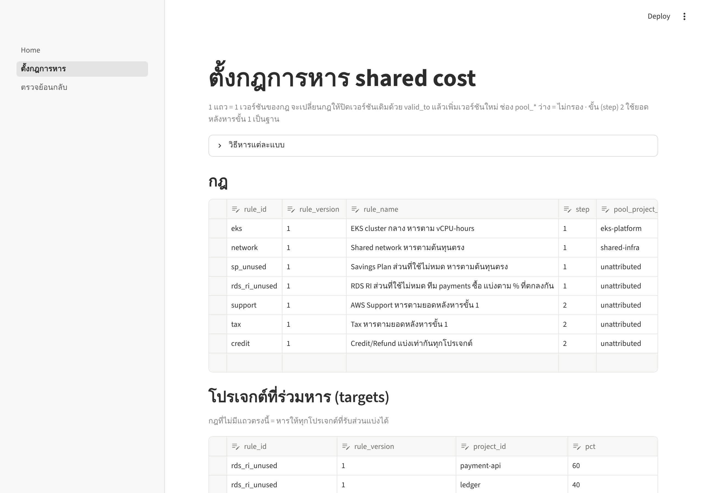

# cloud-cost-mgmt

[](https://github.com/KrisanaP/cloud-cost-mgmt/actions/workflows/dbt.yml)
[](https://github.com/KrisanaP/cloud-cost-mgmt/actions/workflows/dashboard.yml)


**How much does each project really spend on AWS, when resources are shared and tags are late or wrong?**

A mini cloud cost management tool (in the spirit of Datadog CCM) built on **dbt + DuckDB** over a simulated
AWS Cost and Usage Report (CUR 2.0). Every dollar on the bill ends up on a project, and a test proves the
allocated total equals the bill to the cent, every month.

[ภาษาไทย](README.th.md) · [Roadmap](docs/ROADMAP.md) · [Design decisions](docs/decisions/) · [Articles](docs/articles/)

## The problem

| Pain | What usually happens | What this project does |
| --- | --- | --- |
| Savings Plans and RIs are paid in a monthly fee line | The buying account looks expensive, the teams using them look free | **Effective (amortized) cost** moves commitment cost onto the usage lines that consumed it |
| Tags are not retroactive | A resource tagged in September is "unowned" for July and August forever | **SCD2 ownership overrides** with valid-from / valid-to; fix one seed row and history is recomputed |
| Shared resources (EKS cluster, network, support, tax) | Dumped into "shared" or split by gut feeling | **Versioned allocation rules**: even, fixed %, proportional to direct cost, or usage driver (vCPU-hours), with step-down |
| Rounding | Splitting $10 three ways gives $9.99 | **Largest remainder** allocation, so totals match exactly |
| AWS rewrites the current month several times a day | Appending duplicates cost | **Incremental delete+insert** by billing period, tested with a simulated restatement |

## Architecture


PNG version: [docs/img/architecture.png](docs/img/architecture.png) · source: [docs/architecture.mmd](docs/architecture.mmd) · model-level lineage: [dbt docs](https://krisanap.github.io/cloud-cost-mgmt/dbt-docs/)

No API layer: dbt writes report tables, the dashboard and Streamlit read them directly.

## What the tests guarantee

- Raw file = staging = fact = daily mart, per billing period, for unblended, net and effective cost
- Every Savings Plan / RI fee = cost moved to usage + unused part
- Attribution never adds or drops a row or a cent; ownership date ranges never overlap
- After allocation, each bill line sums back to its original cost, and **the monthly allocated total equals the bill**
- Fixed percentages sum to 100, no rule allocates back into a shared pool, no line matches two rules at the same step
- Unit tests cover mid-month ownership moves, late tags, and each allocation method
- A restatement run rewrites September and checks nothing is duplicated

## Run it

```bash
python3 -m venv .venv && source .venv/bin/activate
pip install -r requirements.txt

cd dbt && dbt build --profiles-dir . && cd ..       # models + 78 data/unit tests
bash scripts/simulate_restatement.sh                 # AWS rewrites a month; totals must not double
pytest -q tests                                      # Streamlit rule validation + page smoke tests
streamlit run streamlit_app/Home.py                  # rules editor + audit trail

python3 scripts/export_marts.py                      # dashboard data (Parquet)
cd dashboard && npm install && npm run sources && npm run dev
```

## Screenshots

| Audit: where did this project's money come from? | Allocation rules editor |
| --- | --- |
|  |  |

## Data

`data/cur2_sample.*` is **simulated**, not a real bill, generated by `scripts/gen_cur2.py`
(1 Jul – 30 Sep 2026, 7 accounts, 50+ AWS services, approximate prices). It deliberately contains a few
real-world problems to find. Usage drivers for the shared EKS cluster are simulated by
`scripts/gen_usage_drivers.py`; in production they would come from CloudWatch Container Insights or OpenCost.

## Stack

dbt-core 1.12 · dbt-duckdb · DuckDB · Evidence · Streamlit · GitHub Actions
