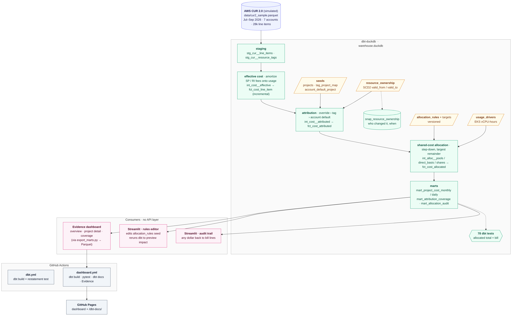

# cloud-cost-mgmt

โปรเจกต์ฝึกสร้างเครื่องมือ Cloud Cost Management แบบ Datadog จาก AWS CUR 2.0

แต่ละโปรเจกต์ใช้เงินจริงเท่าไร เมื่อ resource ใช้ร่วมกันและ tag ไม่มีผลย้อนหลัง
(dbt-duckdb, SCD2 retroactive tagging, shared-cost allocation)

- แผนทั้งหมด: [`docs/ROADMAP.md`](docs/ROADMAP.md)
- สิ่งที่คุยกันมาก่อนหน้า: [`docs/HANDOFF.md`](docs/HANDOFF.md)
- เริ่มที่: Phase 0 ใน roadmap (วอร์ม SQL ด้วย [`exercises/phase1.sql`](exercises/phase1.sql) ได้ถ้าอยาก)

## Architecture



แผนภาพ Mermaid แบบแก้ได้อยู่ที่ [](docs/architecture.mmd) (README อังกฤษแสดงแบบ Mermaid)

## Quickstart

```bash
python3 -m venv .venv && source .venv/bin/activate
pip install -r requirements.txt
duckdb -c "SELECT line_item_product_code, round(sum(line_item_unblended_cost),2) AS cost
           FROM 'data/cur2_sample.parquet' GROUP BY 1 ORDER BY 2 DESC LIMIT 10"
```

รัน dbt (เฟส 0 ขึ้นไป):

```bash
cd dbt && dbt build --profiles-dir .
```

ใช้กับ Claude Code: เปิดเทอร์มินัลในโฟลเดอร์นี้แล้วพิมพ์ `claude` — บริบทของโปรเจกต์อยู่ใน `CLAUDE.md`

## ข้อมูล

`data/cur2_sample.*` เป็นข้อมูลจำลอง (ไม่ใช่บิลจริง) สร้างจาก `scripts/gen_cur2.py`
ช่วง 1 ก.ค. – 30 ก.ย. 2026, 7 บัญชี, 50+ บริการ AWS ราคาเป็นค่าประมาณ
