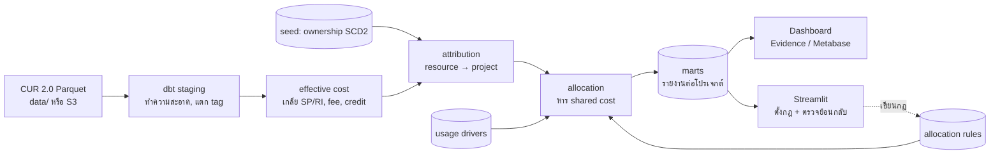

# Roadmap v2: Cloud Cost Management แบบ dbt เป็นแกน

เวอร์ชัน 5 พ.ย. 2026 (แทนฉบับเดิม ซึ่งย้ายไปเก็บที่ `docs/archive/ROADMAP_v1.md`)

## เป้าหมาย

พอร์ตโฟลิโอสายดาต้าที่ตอบคำถามเดียวให้ถูก: **"แต่ละโปรเจกต์ใช้เงินจริงเท่าไร"**
แม้ resource จะใช้ร่วมกันหลายโปรเจกต์ และแม้ tag จะติดผิดหรือติดช้า

จุดเด่นของพอร์ต (เรียงตามความสำคัญ)

1. **Tag ย้อนหลัง (SCD Type 2)** — แก้เจ้าของ resource ครั้งเดียว ตัวเลขในอดีตถูกทั้งหมด
2. **กฎหารต้นทุนที่ใช้ร่วมกัน** — หารเท่ากัน, ตามสัดส่วนที่ตกลง, ตามปริมาณที่ใช้จริง
3. **ตรวจย้อนกลับได้ทุกบาท** — ตัวเลขของโปรเจกต์ไล่กลับไปถึงบรรทัดในบิลและกฎที่ใช้หารได้
4. **ยอดรวมหลังหาร = ยอดในบิลเสมอ** — เป็น dbt test ตั้งแต่วันแรก

สิ่งที่ตัดออกจากแผนเดิม: **ชั้น API** (dbt เขียนตารางรายงาน แล้วให้แดชบอร์ดอ่านตรง)
และ **frontend ที่เขียนเอง** (ใช้แดชบอร์ดสำเร็จรูป + Streamlit แค่ 2 หน้า)

## สถาปัตยกรรม



ทุกอย่างอยู่ใน DuckDB ไฟล์เดียว (`warehouse.duckdb`) สร้างใหม่ได้ทั้งหมดด้วย `dbt build`

## ภาพรวม phase

เวลาที่มี: เสาร์อาทิตย์เต็มวัน + วันธรรมดาช่วงละ 1–2 ชม. (ราว 15–20 ชม./สัปดาห์)

| Phase | เรื่อง | เวลาโดยประมาณ | เสร็จเมื่อ |
| --- | --- | --- | --- |
| 0 | ตั้งเครื่องมือ + ปูพื้น billing | 1 สัปดาห์ | `dbt build` ผ่านบน GitHub จากเบราว์เซอร์ใน iPad |
| 1 | Staging + effective cost + กระทบยอด | 2–3 สัปดาห์ | ยอดใน dbt ตรงกับยอดดิบทุกเดือน ทุก cost type |
| 2 | Tag ย้อนหลัง (SCD2) | 2–3 สัปดาห์ | แก้ seed 1 บรรทัด แล้วต้นทุนเดือนก่อนย้ายโปรเจกต์ถูกต้อง |
| 3 | หารต้นทุนที่ใช้ร่วมกัน | 3–4 สัปดาห์ | หาร 3 แบบได้ และยอดหลังหาร = ยอดบิลถึงเซ็นต์ |
| 4 | แสดงผล: แดชบอร์ด + Streamlit 2 หน้า | 2–3 สัปดาห์ | คนไม่รู้ SQL ตอบได้ว่าโปรเจกต์ X ใช้เท่าไรและมาจากไหน |
| 5 | ทำให้เป็นพอร์ต | 1–2 สัปดาห์ | repo สาธารณะ มี CI, docs, บทความ, demo |
| 6 | ต่อยอด (เลือกทำ) | ตามสนใจ | — |

MVP ที่เอาไปโชว์ได้ = Phase 0–4 ราว 10–14 สัปดาห์ Phase ที่ยากและควรเผื่อเวลาที่สุดคือ Phase 3

---

## Phase 0 — ตั้งเครื่องมือ + ปูพื้น billing (1 สัปดาห์)

**ทำงานบน iPad ยังไง:** dbt, DuckDB, Streamlit ต้องรันบนเครื่องที่มี Python ซึ่ง iPad ไม่มี
ทางเลือกที่ใช้ผ่านเบราว์เซอร์ได้:

- **Claude Code บนเว็บ** (claude.ai/code) — สั่งงานผ่านแชท Claude รัน dbt ใน cloud แล้ว push ให้
- **GitHub Codespaces** — VS Code ในเบราว์เซอร์ รันคำสั่งเองได้ (ฟรีราว 60 ชม./เดือน)
- **Mac** — วันเสาร์อาทิตย์ถ้าสะดวก ใช้ทำงานที่ต้องเปิดหลายหน้าต่าง เช่น Metabase

สิ่งที่ต้องทำ

- [ ] push repo ขึ้น GitHub (public ได้ เพราะใช้ข้อมูลจำลอง; `ANSWER_KEY.md` อยู่ใน `.gitignore` แล้ว)
- [ ] `dbt init` ด้วย adapter `dbt-duckdb` โครงสร้าง `models/staging`, `models/intermediate`, `models/marts`, `seeds/`
- [ ] GitHub Actions รัน `dbt build` ทุกครั้งที่ push (test พังแล้วรู้ทันที)
- [ ] ทบทวน billing: line item type ทั้ง 10 แบบ, unblended / net / amortized ต่างกันยังไง
      (อ่านจาก `CLAUDE.md` ส่วน "ข้อเท็จจริงเกี่ยวกับข้อมูล" + CUR 2.0 table dictionary)
- [ ] ถามสามีเรื่อง "รูปร่าง" ของปัญหา (รายการคำถามอยู่ใน `docs/HANDOFF.md`)
      เพื่อเอาไปออกแบบ project, shared resource และกฎการหารใน Phase 2–3

ทางเลือก (ถ้าอยากวอร์ม SQL ก่อน): `exercises/phase1.sql` 10 ข้อ ใช้ข้อมูลชุดเดียวกัน
ข้อ 1 กับข้อ 10 เป็นพื้นฐานของ Phase 1 โดยตรง

## Phase 1 — Staging, effective cost, กระทบยอด (2–3 สัปดาห์)

จบ phase นี้เมื่อ `fct_cost_line_item` มีต้นทุนที่ "ใช้คิดให้โปรเจกต์ได้" ทุกบรรทัด
และ test ยืนยันว่ายอดรวมตรงกับไฟล์ดิบทุก billing period

โมเดลที่ต้องมี

| โมเดล | หน้าที่ |
| --- | --- |
| `stg_cur__line_items` | อ่าน Parquet, cast type, ตั้งชื่อคอลัมน์ให้อ่านง่าย, แตก JSON (`resource_tags`, `cost_category`) |
| `stg_cur__resource_tags` | tag แบบยาว 1 แถวต่อ line item × tag key (normalize ชื่อ key และค่า) |
| `int_cost__effective` | คิด **effective cost** ต่อบรรทัด: SP covered ใช้ `savings_plan_savings_plan_effective_cost`, RI ใช้ `reservation_effective_cost`, ตัด negation, แยก commitment ที่ใช้ไม่หมดออกเป็นบรรทัดของตัวเอง |
| `fct_cost_line_item` | grain = 1 line item; มี unblended, net, effective, และ `cost_class` (direct / commitment_unused / tax / support / credit / fee) |
| `fct_cost_daily` | grain = วัน × account × service × resource สำหรับรายงาน |

แนวคิดสำคัญ

1. **Effective cost คือฐานของทุกอย่างหลังจากนี้** ถ้าเลือกผิด การหารใน Phase 3 จะผิดตามหมด
   เขียนสรุปสั้นๆ ใน `docs/decisions/` ว่าทำไมเลือก effective (amortized) ไม่ใช่ unblended หรือ blended
2. **Restatement** — AWS เขียนทับไฟล์เดือนปัจจุบันวันละหลายรอบ ห้าม append
   ใช้ incremental model แบบ `delete+insert` ด้วย key `bill_billing_period_start_date`
3. **กระทบยอด (reconciliation)** — test ต่อ billing period: ยอด raw = ยอด staging = ยอด fact
   ทั้ง unblended และ effective

dbt tests ที่ต้องมี

- [x] `unique` + `not_null` บน `identity_line_item_id`
- [x] `accepted_values` ของ `line_item_line_item_type`
- [x] custom test `assert_totals_match_raw` ต่อ billing period (ยอมให้ต่างไม่เกิน $0.01)
- [x] จำลอง restatement: generate เดือนเดิมด้วย seed ใหม่ แล้วรันซ้ำ ยอดต้องไม่ซ้ำ

## Phase 2 — Tag ย้อนหลัง (SCD2) (2–3 สัปดาห์)

จบ phase นี้เมื่อเพิ่มบรรทัดเดียวใน seed ว่า "resource นี้เป็นของโปรเจกต์ B ตั้งแต่ 1 ส.ค."
แล้ว `dbt build` ใหม่ ต้นทุนเดือน ส.ค.–ก.ย. ของ resource นั้นย้ายไปโปรเจกต์ B ทั้งหมด
โดยยอดรวมทั้งบริษัทไม่เปลี่ยน

ข้อมูลที่ต้องสร้างเพิ่ม (ข้อมูลจำลองยังไม่มีแนวคิด "โปรเจกต์")

- `seeds/projects.csv` — รายชื่อโปรเจกต์, ทีมเจ้าของ, cost center
- `seeds/resource_ownership.csv` — ตาราง SCD2:
  `resource_id, project_id, valid_from, valid_to, source, changed_by, changed_at, reason`
- `seeds/account_default_project.csv` — ถ้าไม่มี tag และไม่มี override ให้ตกที่โปรเจกต์ไหนตาม account
- ออกแบบสถานการณ์ทดสอบเองอย่างน้อย: resource ที่ย้ายเจ้าของกลางเดือน, resource ที่ไม่มี tag เลย,
  resource ที่ tag มาช้า (ติดเดือน ก.ย. แต่ใช้มาตั้งแต่ ก.ค.)

ลำดับการตัดสินว่าบรรทัดนี้เป็นของใคร (เขียนเป็น `int_cost__attributed`)

1. override ใน `resource_ownership` ที่ช่วงวันครอบ `usage_date`
2. tag ใน CUR (หลัง normalize แล้ว map tag → project)
3. ค่า default ของ account
4. `unattributed` (ห้ามทิ้ง ต้องโผล่ในรายงาน)

ทุกบรรทัดเก็บ `attribution_source` ไว้ด้วย เพื่อให้หน้าตรวจย้อนกลับบอกได้ว่าได้เจ้าของมาจากทางไหน

แนวคิดสำคัญ

- **effective date กับ record date ต่างกัน** — `valid_from/valid_to` คือ "เป็นเจ้าของจริงตั้งแต่เมื่อไร"
  ส่วน `changed_at` คือ "เรารู้/แก้เมื่อไร" ใช้ `dbt snapshot` บนตาราง ownership
  เพื่อเก็บประวัติว่าใครแก้อะไรเมื่อไร (ตอบคำถาม "ทำไมตัวเลขเดือน ก.ค. เปลี่ยนไปจากที่รายงานเมื่อวาน")
- **join แบบช่วงวันต้องไม่ทำให้แถวงอก** — ถ้าช่วงวันซ้อนกัน 1 บรรทัดบิลจะได้ 2 เจ้าของ แล้วยอดเบิ้ล

dbt tests ที่ต้องมี

- [x] custom test `assert_no_overlapping_ranges` ต่อ resource
- [x] จำนวนแถวก่อนและหลัง attribution เท่ากัน
- [x] ยอดรวมก่อนและหลัง attribution เท่ากัน
- [x] `relationships` ทุก `project_id` ต้องมีใน `projects`

## Phase 3 — หารต้นทุนที่ใช้ร่วมกัน (3–4 สัปดาห์)

จบ phase นี้เมื่อ shared cost ทุกก้อนถูกหารลงโปรเจกต์ตามกฎ 3 แบบ
และ test ยืนยันว่ายอดรวมหลังหาร = ยอดในบิล ถึงหลักเซ็นต์ ทุกวัน

Shared cost ในข้อมูลจำลองที่ใช้ฝึกได้ (ลองหาเองว่ามีอะไรอีก):
ค่า AWS Support, Tax, NAT Gateway / network account, security account,
ฐานข้อมูลหรือ cluster ที่หลายโปรเจกต์ใช้ร่วมกัน, ส่วนของ commitment (SP/RI) ที่ไม่ได้ผูกกับ resource ไหน

ตารางกฎ `allocation_rules` (Streamlit เขียน, dbt อ่าน)

| คอลัมน์ | ความหมาย |
| --- | --- |
| `rule_id`, `rule_name` | |
| `pool_filter` | เลือกบรรทัดที่เป็น shared cost (account / service / usage_type / resource_id / cost_class) |
| `method` | `even` / `fixed_pct` / `proportional_direct` (ตามต้นทุนตรง) / `usage_driver` (ตามปริมาณใช้จริง) |
| `targets` | โปรเจกต์ที่ร่วมหาร (+ % ถ้าเป็น fixed_pct) |
| `driver_metric` | ใช้กับ `usage_driver` เช่น จำนวน request, GB, vCPU-hours |
| `step` | ลำดับการหารแบบขั้นบันได (เช่น หาร network ก่อน แล้วค่อยหาร support ตามยอดหลังหาร) |
| `valid_from`, `valid_to` | กฎก็มีช่วงวันที่มีผล (SCD2 เหมือน Phase 2) |

ข้อมูลที่ต้องสร้างเพิ่ม: `seeds/usage_drivers.csv` (วัน × resource × project × ปริมาณ)
เพราะปริมาณการใช้จริงของแต่ละโปรเจกต์ **ไม่อยู่ในบิล** ของจริงต้องมาจาก log, CloudWatch หรือ OpenCost

โมเดล

- `int_alloc__pools` — บรรทัดที่เข้าเงื่อนไขกฎ จัดเป็นก้อน
- `int_alloc__shares` — % ของแต่ละโปรเจกต์ต่อก้อนต่อวัน
- `fct_cost_allocated` — grain = line item × project มี `allocated_cost`, `rule_id`, `rule_version`,
  `share_pct`, `is_shared` → นี่คือตารางที่หน้าตรวจย้อนกลับใช้

แนวคิดสำคัญ

- **เศษสตางค์** — หาร $10.00 ให้ 3 โปรเจกต์ได้ 3.33 × 3 = 9.99 ใช้วิธี largest remainder
  ให้เศษไปตกที่โปรเจกต์ที่มีเศษมากสุด ยอดรวมจึงตรงเป๊ะ
- **กฎห้ามวนกัน** — โปรเจกต์ A หารให้ B แล้ว B หารกลับให้ A ไม่ได้ (ตรวจด้วย step)
- **บรรทัดที่ไม่เข้ากฎไหนเลย** ต้องคงเป็นของเดิม ห้ามหาย

dbt tests ที่ต้องมี

- [x] `assert_allocation_conserves_cost` — ต่อวัน ต่อก้อน: ยอดหลังหาร = ยอดก่อนหาร
- [x] `fixed_pct` ของแต่ละกฎรวมกัน = 100%
- [x] ไม่มี `allocated_cost` ติดลบ ยกเว้นบรรทัด credit/refund
- [x] ยอดรวม `fct_cost_allocated` ทั้งเดือน = ยอดบิลทั้งเดือน (test เดียวที่สำคัญที่สุดของโปรเจกต์)

## Phase 4 — แสดงผล (2–3 สัปดาห์)

จบ phase นี้เมื่อคนที่ไม่รู้ SQL ตอบได้ภายใน 3 คลิกว่า
"เดือน ส.ค. โปรเจกต์ X ใช้เท่าไร เป็นต้นทุนตรงเท่าไร ได้รับหารมาเท่าไร จากกฎอะไร"

ขั้นแรก: ให้ Claude ร่างหน้าตาแดชบอร์ดเป็น artifact จากข้อมูลจำลอง เอาไปให้สามีดูก่อนลงมือ

Marts ที่แดชบอร์ดอ่าน

- `mart_project_cost_monthly` — โปรเจกต์ × เดือน × direct / shared / total
- `mart_project_cost_daily` — สำหรับกราฟแนวโน้ม
- `mart_attribution_coverage` — % ต้นทุนที่ยัง `unattributed` แยกตาม account / service
- `mart_allocation_audit` — โปรเจกต์ × บรรทัดบิล × กฎ (ใช้ในหน้าตรวจย้อนกลับ)

**4.1 แดชบอร์ดสำเร็จรูป** (ยังไม่ไฟนอล)

| | Evidence.dev | Metabase |
| --- | --- | --- |
| วิธีทำ | เขียน SQL ใน Markdown ได้หน้ารายงาน | ลากวางในหน้าเว็บ |
| ต่อ DuckDB | ในตัว | ต้องลง community driver |
| รันที่ไหน | build เป็นเว็บ static ฝากบน GitHub Pages / Netlify ได้ | ต้องมี server (Docker/Java) |
| เหมาะกับ iPad | ดี แก้ไฟล์ใน repo แล้ว CI build ให้ | ต้องเปิดเครื่อง Mac ไว้ |
| โชว์ในพอร์ต | มีลิงก์ให้คนกดดูได้เลย | ต้องอัดวิดีโอ/ภาพ |

แนะนำ Evidence สำหรับเฟสนี้ เพราะเหมาะกับการทำงานบน iPad และมีลิงก์เปิดให้ดูได้จริง
แต่ถ้าสามีอยากลองเล่นเองแบบลากวาง Metabase ดีกว่า

หน้าที่ควรมี: Overview (ยอดต่อโปรเจกต์ เทียบเดือนก่อน), Project detail (direct vs shared, top service),
Coverage (ต้นทุนที่ยังไม่มีเจ้าของ + รายการ resource ที่ต้องไปแก้)

**4.2 Streamlit หน้า 1: ตั้งกฎการหาร**

- ดู/เพิ่ม/แก้กฎ บันทึกลง `allocation_rules` (ตารางใน DuckDB หรือไฟล์ CSV ใน `seeds/`)
- ตรวจก่อนบันทึก: % รวม 100, โปรเจกต์มีจริง, ช่วงวันไม่ซ้อน
- **Preview ผลกระทบ** — ก่อน/หลังใช้กฎ แต่ละโปรเจกต์เปลี่ยนไปเท่าไร
- ปุ่มรัน `dbt build --select +fct_cost_allocated+`

**4.3 Streamlit หน้า 2: ตรวจย้อนกลับ**

- เลือกโปรเจกต์ + เดือน → แตกเป็น direct / shared
- กดที่ก้อน shared → เห็นกฎ, % ที่ได้, driver ที่ใช้คิด
- กดลงไปอีก → เห็นบรรทัดบิลต้นทาง (`identity_line_item_id`) และ `attribution_source`
- ถ้ามีการแก้ ownership ย้อนหลัง แสดงว่าใครแก้ เมื่อไร (จาก dbt snapshot)

Streamlit เป็นงาน frontend ที่ Claude ช่วยเขียนให้ได้เต็มที่ จุดที่ควรคิดเองคือ SQL ที่หน้าเหล่านี้เรียก

## Phase 5 — ทำให้เป็นพอร์ต (1–2 สัปดาห์)

- [ ] README ภาษาอังกฤษ: ปัญหา → แนวทาง → สถาปัตยกรรม → วิธีรัน (คนอ่านต้องเข้าใจใน 2 นาที)
- [ ] `dbt docs generate` แล้วฝากบน GitHub Pages — lineage graph คือภาพที่โชว์งาน data eng ได้ดีที่สุด
- [ ] Badge CI ผ่าน, จำนวน test
- [ ] Demo: ลิงก์แดชบอร์ด + GIF ของ Streamlit 2 หน้า
- [ ] บทความ 2–3 ตอน เช่น "ทำไม tag ย้อนหลังไม่ได้ และแก้ด้วย SCD2 ยังไง",
      "หารต้นทุนร่วมให้ยอดตรงบิลทุกเซ็นต์", "effective cost: ทำไมยอดบิลมี 3 ตัวเลข"

## Phase 6 — ต่อยอด (เลือกทำตามสนใจ)

| เรื่อง | ทำอะไร | หมายเหตุ |
| --- | --- | --- |
| AI เดาเจ้าของ resource | ให้ LLM เดาโปรเจกต์ของ resource ที่ไม่มี tag จากชื่อ, account, resource ข้างเคียง → แสดงใน Streamlit ให้คนกดยืนยันก่อนเขียนลง `resource_ownership` | ต่อจาก Phase 2 ได้ทันที |
| กระทบยอดเงินบาท | อัตราแลกเปลี่ยน, VAT, ใบแจ้งหนี้ของตัวแทนจำหน่าย | ปัญหาจริงของบริษัทไทย |
| ข้อมูลจริงจาก AWS | เปิดบัญชีตัวเอง (ตั้ง budget alert ก่อน), CUR 2.0 → S3 → โหลดด้วย boto3/dlt อ่าน manifest | |
| FOCUS / หลายคลาวด์ | map CUR → FOCUS ใช้ FOCUS Sandbox / sample data ทดสอบ | |
| Kubernetes | OpenCost แบ่งค่า cluster ที่ใช้ร่วมกัน | ยากที่สุดในรายการ |
| Anomaly + budget | rolling z-score, forecast สิ้นเดือน, แจ้งเตือน | ข้อมูลจำลองมีเรื่องผิดปกติฝังไว้ให้หา |

## โครงสร้าง repo เป้าหมาย

```
dbt/                     โปรเจกต์ dbt-duckdb
  models/staging/        stg_cur__*
  models/intermediate/   int_cost__*, int_alloc__*
  models/marts/          fct_*, mart_*
  seeds/                 projects, resource_ownership, allocation_rules, usage_drivers
  snapshots/             ประวัติการแก้ ownership
  tests/                 custom tests (กระทบยอด, ช่วงวันซ้อน, หารแล้วยอดคงเดิม)
dashboard/               Evidence (หรือ Metabase config)
streamlit_app/           2 หน้า: rules, audit
data/                    CUR 2.0 จำลอง
scripts/gen_cur2.py      generator
docs/                    ROADMAP, HANDOFF, decisions/
```

## แหล่งเรียนรู้

- [dbt-duckdb](https://github.com/duckdb/dbt-duckdb), [dbt snapshots](https://docs.getdbt.com/docs/build/snapshots), [dbt data tests](https://docs.getdbt.com/docs/build/data-tests)
- [CUR 2.0 table dictionary](https://docs.aws.amazon.com/cur/latest/userguide/table-dictionary-cur2.html)
- [Cloud Intelligence Dashboards (CUDOS)](https://github.com/aws-solutions-library-samples/cloud-intelligence-dashboards-framework) — SQL amortized cost ใช้เทียบคำตอบ Phase 1
- [FinOps Framework: Allocation](https://www.finops.org/framework/capabilities/allocation/) — แนวคิดการหาร shared cost
- [Evidence.dev](https://evidence.dev/), [Metabase](https://www.metabase.com/), [Streamlit](https://streamlit.io/)
- [FOCUS spec](https://focus.finops.org/) และ [FOCUS Sandbox](https://focus.finops.org/sandbox/)
