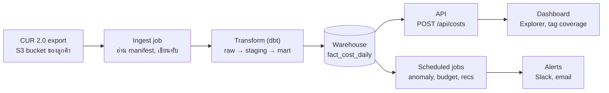

# โจทย์: สร้าง Cloud Cost Management แบบ Datadog

เวอร์ชัน 21 ต.ค. 2026

## ภาพรวมโจทย์

เป้าหมาย: สร้าง "mini Cloud Cost Management" ที่อ่าน AWS CUR 2.0 แล้วตอบได้ว่า **เงินหมดไปกับอะไร ของทีมไหน ผิดปกติตรงไหน และประหยัดได้เท่าไร** ใช้เวลาประมาณ 18–22 สัปดาห์ถ้าทำนอกเวลา

[Datadog Cloud Cost Management](https://www.datadoghq.com/product/cloud-cost-management/) รวมค่าใช้จ่าย cloud, container, SaaS และ AI ไว้ที่เดียว แล้วกระจายให้ทีมหรือ service พร้อมแจ้งเตือนเมื่อค่าใช้จ่ายผิดปกติและแนะนำวิธีประหยัด โจทย์นี้เลือกทำเฉพาะ AWS ก่อน เพราะเป็นแกนของทุกฟีเจอร์

| ฟีเจอร์ของ Datadog | เวอร์ชันของเรา | Phase |
| --- | --- | --- |
| Cost explorer + dashboard | กราฟค่าใช้จ่ายรายวัน group by service / account / tag | 1, 3, 4 |
| Allocation + Tag Pipelines | กฎแปลง tag และแบ่ง shared cost ให้ทีม | 5 |
| Anomaly detection | ตรวจจับ spike รายวัน แจ้งเตือนผ่าน Slack / email | 5 |
| Budgets | ตั้งงบต่อทีม พยากรณ์ยอดสิ้นเดือน | 5 |
| Recommendations | หา resource ที่ idle / เกินขนาด / ใช้ type เก่า | 5 |
| Commitments | วัด coverage และ utilization ของ Savings Plans / RI | 5 |
| Container cost | แบ่งค่า EKS / ECS ลงระดับ namespace / service | 5 |
| FOCUS ingestion | แปลง CUR เป็น schema FOCUS เพื่อรองรับ cloud อื่นในอนาคต | 6 |

ข้อมูลสำหรับฝึก: `data/cur2_sample.parquet` (มี anomaly, resource ที่ไม่ได้ tag และ commitment ฝังไว้ให้หา)

```mermaid
gantt
    title MVP พร้อมโชว์สัปดาห์ที่ 13, ครบทุก phase ใน 22 สัปดาห์
    dateFormat  X
    axisFormat  W%s
    Phase 0 ปูพื้น billing      : 1, 3
    Phase 1 SQL บน CUR          : 3, 5
    Phase 2 Data pipeline       : 5, 8
    Phase 3 Backend API         : 8, 11
    Phase 4 Dashboard           : 11, 14
    MVP พร้อมโชว์               : milestone, 14, 0
    Phase 5 ฟีเจอร์ขั้นสูง       : 14, 20
    Phase 6 Production          : 20, 23
```

Phase 0–4 คือ MVP ที่เอาไปโชว์ได้ ส่วน Phase 5 เลือกทำเฉพาะฟีเจอร์ที่สนใจได้ ถ้าเวลาน้อยให้ตัด Phase 6 ออกก่อน

## Phase 0 — ปูพื้น AWS billing และ FinOps (1–2 สัปดาห์)

จบ phase นี้เมื่ออธิบายได้ว่าทำไมบิลเดียวกันถึงมี "ค่าใช้จ่าย" ได้ 3 ตัวเลข คือ unblended, net และ amortized

สิ่งที่ต้องศึกษา

1. **โครงสร้างบัญชี** — AWS Organizations, payer account กับ linked account, consolidated billing
2. **Line item type** — `Usage`, `Tax`, `Credit`, `Refund`, `Fee`, `DiscountedUsage` (RI), `SavingsPlanCoveredUsage`, `SavingsPlanRecurringFee`, `SavingsPlanNegation`
3. **ค่าใช้จ่าย 3 มุม**
    1. Unblended — ราคาจริงตอนใช้
    2. Net — หักส่วนลด (EDP, private pricing) แล้ว
    3. Amortized — เกลี่ยค่า upfront ของ RI / SP ไปตามการใช้งาน ใช้ตอบคำถาม "ทีมนี้ใช้จริงเท่าไร"
4. **Pricing model** — On-Demand, Reserved Instances, Savings Plans (Compute / EC2 Instance), Spot
5. **Tagging** — user tag กับ AWS-generated tag, การเปิด cost allocation tags, ทำไม tag ย้อนหลังไม่ได้
6. **FinOps Framework** — 3 ระยะ Inform → Optimize → Operate และ persona (engineer, finance, leadership)
7. **FOCUS spec** — schema กลางของ FinOps Foundation ที่ใช้รวมบิลหลาย cloud

แบบฝึก

- [ ] สมัคร AWS Free Tier เปิด Billing console และ Cost Explorer ดูหน้าตาจริง
- [ ] สร้าง Data Export แบบ CUR 2.0 ลง S3 (ข้อมูลแรกมาภายใน 24 ชม.)
- [ ] อ่าน [CUR 2.0 table dictionary](https://docs.aws.amazon.com/cur/latest/userguide/table-dictionary-cur2.html) จดความหมายของ 30 คอลัมน์ที่ใช้บ่อย
- [ ] เขียนสรุป 1 หน้า: line item type แต่ละแบบควรนับในยอด "ค่าใช้จ่ายของทีม" หรือไม่

## Phase 1 — สำรวจ CUR 2.0 ด้วย SQL (2 สัปดาห์)

จบ phase นี้เมื่อเขียน SQL ตอบคำถามทั้ง 10 ข้อด้านล่างได้ และตัวเลขตรงกับที่คิดมือ ใช้ [DuckDB](https://duckdb.org/) เพราะอ่าน Parquet ได้ตรงๆ ไม่ต้องตั้ง server

สิ่งที่ต้องศึกษา: SQL ระดับ window function (`LAG`, `AVG OVER`), การอ่านคอลัมน์ nested (`map` / JSON) และ Jupyter + pandas สำหรับวาดกราฟเร็วๆ

โจทย์ 10 ข้อบน sample dataset (เติมคำตอบใน `exercises/phase1.sql`)

- [ ] ยอดรวมแยกตาม `line_item_line_item_type` — อะไรควรตัดออกเวลาคิดค่าใช้จ่ายของทีม
- [ ] Top 10 service ตามค่าใช้จ่าย และ top 10 resource ID
- [ ] ค่าใช้จ่ายรายวันแยกตาม account (กราฟเส้น)
- [ ] แตก tag `user_team` ออกจาก `resource_tags` แล้วหา % ค่าใช้จ่ายที่ไม่ได้ tag
- [ ] หาวันที่ S3 ของ `acme-data` เริ่มพุ่ง ด้วยการเทียบกับค่าเฉลี่ย 7 วันก่อนหน้า
- [ ] เทียบ on-demand กับ effective cost ของ EC2 ที่ใช้ Savings Plan — ประหยัดไปเท่าไร คุ้มกับ recurring fee ไหม
- [ ] Week-over-week change ต่อ service
- [ ] ค่าใช้จ่ายแยก region และแยก usage type (เช่น `NatGateway-Bytes` กับ `NatGateway-Hours`)
- [ ] Cost per environment (prod / staging) ต่อ business unit จาก `cost_category`
- [ ] เขียน view `daily_cost` ที่ group ให้เหลือ 1 แถวต่อ วัน × account × service × team

ข้อ 10 คือหัวใจของทั้งโปรเจกต์ เพราะ API และ dashboard ใน phase ถัดไปจะ query จาก view นี้

## Phase 2 — Data pipeline ingest CUR (3 สัปดาห์)

จบ phase นี้เมื่อวางไฟล์ CUR ใหม่ลง S3 (หรือโฟลเดอร์ local) แล้วตาราง `daily_cost` อัปเดตเองโดยไม่มีข้อมูลซ้ำ

Phase 2 สร้างแถวบนทั้งแถว ส่วน API, dashboard และ jobs ใน phase ถัดไปอ่านจาก warehouse ตัวเดียวกันหมด

สิ่งที่ต้องศึกษาและลองทำ

1. **อ่าน manifest** — Data Exports ส่งไฟล์เป็นชุดพร้อม `Manifest.json` ต้องอ่าน manifest ก่อนเพื่อรู้ว่าไฟล์ไหนเป็นของรอบล่าสุด
2. **Restatement** — AWS ส่งข้อมูลของเดือนเดิมซ้ำหลายรอบตลอดเดือน (และแก้ย้อนหลังได้หลังปิดเดือน) ห้าม append ให้ **เขียนทับทั้ง billing period** ทุกครั้ง
3. **Idempotency** — รัน job ซ้ำกี่รอบผลต้องเหมือนเดิม ใช้ `bill_billing_period_start_date` + version ของ export เป็น key
4. **Transform เป็นชั้น** — raw (ไฟล์ดิบ) → staging (ทำความสะอาด, แตก tag, คิด amortized cost) → mart (`daily_cost`, `monthly_cost`) ลองใช้ [dbt](https://www.getdbt.com/) จัดการชั้น transform
5. **เลือก storage** — เริ่มจาก DuckDB ไฟล์เดียว พอข้อมูลเกินหลายสิบล้านแถวค่อยย้ายไป ClickHouse หรือ Postgres + partition ตามเดือน
6. **Scheduler** — เริ่มด้วย cron ต่อมาลอง S3 event → SQS → worker หรือ Dagster / Airflow

แบบฝึก

- [ ] เขียน ingest job ที่รับ path ของไฟล์ แล้วเขียนทับข้อมูลเดือนนั้น
- [ ] Generate ข้อมูลเดือนใหม่ด้วย `scripts/gen_cur2.py` แล้วจำลอง restatement (รันเดือนเดิมด้วย seed ใหม่) ตรวจว่ายอดรวมไม่ซ้ำ
- [ ] เขียน data test: ยอดรวมใน mart = ยอดรวมใน raw ต่อเดือน, ไม่มี `identity_line_item_id` ซ้ำ

## Phase 3 — Backend API + data model (2–3 สัปดาห์)

จบ phase นี้เมื่อ frontend เรียก API เดียวแล้วได้ค่าใช้จ่ายแบบ group by / filter อะไรก็ได้ ภายใน 1 วินาที

Data model แบบ star schema

| ตาราง | ประเภท | คอลัมน์หลัก |
| --- | --- | --- |
| `fact_cost_daily` | fact | date, account_id, service, region, usage_type, resource_id, unblended, net, amortized, usage_amount |
| `fact_cost_tags` | bridge | fact id, tag_key, tag_value (รองรับ tag กี่ตัวก็ได้) |
| `dim_account` | dimension | account_id, name, environment, owner |
| `dim_service` | dimension | product_code, ชื่อแสดงผล, category (compute / storage / network / database) |
| `dim_team` | dimension | team, budget, Slack channel |

สิ่งที่ต้องศึกษาและลองทำ

1. **Query builder** — endpoint เดียว `POST /api/costs` รับ `{date_range, group_by[], filters[], metric, granularity}` แล้วสร้าง SQL ปลอดภัย (whitelist คอลัมน์ ห้ามต่อ string ตรงๆ)
2. **Endpoint อื่น** — `/api/dimensions/{name}/values` (สำหรับ dropdown), `/api/costs/top-movers`, `/api/tags/coverage`
3. **Performance** — pre-aggregate ตารางรายวัน, cache ผลลัพธ์ (Redis หรือ in-memory) เพราะข้อมูลเปลี่ยนแค่วันละครั้ง
4. **Testing** — unit test ของ query builder และ integration test กับ sample data ที่รู้คำตอบล่วงหน้า

แบบฝึก

- [ ] เขียน OpenAPI spec ก่อนเขียนโค้ด
- [ ] ทำให้คำถาม 10 ข้อใน Phase 1 ตอบได้ผ่าน API ทั้งหมด

## Phase 4 — Frontend dashboard (3 สัปดาห์)

จบ phase นี้เมื่อคนที่ไม่รู้ SQL เปิดหน้าเว็บแล้วหาคำตอบได้ว่า "เดือนนี้ทีม data ใช้เงินเพิ่มเพราะ service ไหน" ภายใน 3 คลิก

หน้าจอที่ต้องมี

1. **Overview** — ยอดเดือนนี้, เทียบเดือนก่อน, forecast สิ้นเดือน, top 5 service, top movers
2. **Cost Explorer** — เลือกช่วงเวลา, group by, filter หลายชั้น, สลับ stacked bar / line / table, export CSV
3. **Tag coverage** — % ค่าใช้จ่ายที่ไม่มี tag แยกตาม account และ service พร้อมรายการ resource ที่ต้องไป tag
4. **Resource detail** — ประวัติค่าใช้จ่ายของ resource เดียว แยกตาม usage type

สิ่งที่ต้องศึกษา

- React + TypeScript, TanStack Query สำหรับ fetch / cache
- Chart library เช่น ECharts หรือ Recharts — ลองทำ stacked bar รายวันที่มี 20+ series ให้อ่านง่าย (เหลือ top 8 + "Other")
- เก็บ state ของ filter ไว้ใน URL เพื่อให้แชร์ลิงก์มุมมองเดียวกันได้
- Format เงินและวันที่ให้ถูก timezone (CUR เป็น UTC)

แบบฝึก

- [ ] ร่าง wireframe บนกระดาษหรือ Figma ก่อนเขียนโค้ด
- [ ] ให้คนอื่นลองใช้ 2 คน แล้วจดว่าติดตรงไหน

## Phase 5 — ฟีเจอร์ขั้นสูง (5–6 สัปดาห์)

Phase นี้คือสิ่งที่ทำให้ต่างจาก Cost Explorer ของ AWS เลือกทำทีละฟีเจอร์ตามลำดับในตาราง แต่ละฟีเจอร์มีเกณฑ์ "เสร็จ" ของตัวเอง

| ลำดับ | ฟีเจอร์ | ต้องศึกษา | เสร็จเมื่อ |
| --- | --- | --- | --- |
| 1 | Tag pipeline | normalize tag (`Team`, `team`, `TEAM` → `team`), map account → team เมื่อไม่มี tag | tag coverage เพิ่มจากเดิมโดยไม่ต้องแก้ resource จริง |
| 2 | Shared cost allocation | กฎแบ่งแบบ even / proportional / fixed % สำหรับ NAT, support, tax, EKS control plane | ยอดรวมหลังแบ่ง = ยอดรวมก่อนแบ่งเสมอ |
| 3 | Anomaly detection | rolling mean + z-score ก่อน, ต่อมา seasonal (STL, Prophet), แยก spike ตาม service × account | จับ spike S3 ใน sample ได้ภายในวันแรก และ false alarm น้อยกว่า 1 ครั้ง/สัปดาห์ |
| 4 | Alert | ส่ง Slack webhook / email พร้อม root cause (resource หรือ usage type ที่โตที่สุด) | ได้ข้อความที่อ่านแล้วรู้ว่าต้องไปดูอะไร |
| 5 | Budgets + forecast | linear / seasonal forecast ยอดสิ้นเดือน, threshold 80% / 100% | แจ้งเตือนก่อนเกินงบอย่างน้อย 5 วัน |
| 6 | Commitments | SP / RI coverage = covered ÷ eligible usage, utilization = ใช้จริง ÷ ที่ซื้อ | ตัวเลขตรงกับ Cost Explorer ของ AWS ±1% |
| 7 | Container cost | EKS split cost allocation data ใน CUR 2.0, ECS task-level cost, แบ่ง node ที่ idle | เห็นค่าใช้จ่ายต่อ namespace / ECS service |
| 8 | Recommendations | กฎ: EBS ที่ไม่ได้ attach, gp2 → gp3, snapshot เก่า, Elastic IP ว่าง, EC2 / RDS ใช้ CPU ต่ำ (ต้องดึง CloudWatch metrics) | แต่ละข้อแนะนำแสดงยอดประหยัดต่อเดือน |

ข้อควรระวัง: recommendation ส่วนใหญ่ต้องใช้ข้อมูลนอก CUR (CloudWatch, AWS Compute Optimizer API, EC2 `describe-*`) ให้เริ่มจากกฎที่ดูจาก CUR อย่างเดียวได้ก่อน เช่น gp2 → gp3 และ public IPv4 ที่ว่าง

## Phase 6 — Production, multi-account, security (2–3 สัปดาห์)

จบ phase นี้เมื่อบริษัทอื่นต่อ AWS ของตัวเองเข้ามาได้เองภายใน 15 นาที โดยไม่ต้องส่ง access key ให้เรา

1. **Onboarding** — ให้ลูกค้ารัน CloudFormation template ที่สร้าง Data Export + IAM role ที่ trust account ของเรา (ใช้ External ID กัน confused deputy) แล้วเรา `AssumeRole` ไปอ่าน S3
2. **Multi-tenant** — ทุกตารางมี `tenant_id`, ทดสอบว่า tenant หนึ่งดึงข้อมูลอีก tenant ไม่ได้
3. **Auth + RBAC** — login (OIDC / Google), role: admin, finance (เห็นทุกอย่าง), engineer (เห็นเฉพาะทีมตัวเอง)
4. **Deploy** — Docker, CI/CD (GitHub Actions), IaC (Terraform), secrets ใน Secrets Manager
5. **Observability ของระบบเอง** — log, metric ของ ingest job, แจ้งเตือนเมื่อ export ไม่มาเกิน 48 ชม.
6. **FOCUS** — map CUR 2.0 → FOCUS เพื่อเตรียมรองรับ Azure / GCP / OpenAI / Anthropic billing ในอนาคต
7. **ค่าใช้จ่ายของตัวระบบ** — วัดว่าต้นทุนต่อลูกค้าต่อเดือนเท่าไร (เครื่องมือ FinOps ที่แพงเองคือมุกตลกที่ไม่มีใครขำ)

## Tech stack แนะนำ และแหล่งเรียนรู้

Stack ด้านล่างเลือกให้เริ่มเร็วบนเครื่องเดียว และขยายได้โดยไม่ต้องเขียนใหม่ทั้งหมด เปลี่ยนตามภาษาที่ถนัดได้

| ชั้น | เริ่มต้น | เมื่อโตขึ้น |
| --- | --- | --- |
| Storage / query | DuckDB + Parquet | ClickHouse หรือ Postgres (partition รายเดือน) |
| Transform | SQL scripts | dbt |
| Orchestration | cron | Dagster / Airflow หรือ S3 event → SQS |
| Backend | Python FastAPI หรือ Go | + Redis cache |
| Frontend | React + TypeScript + ECharts | + TanStack Query |
| Anomaly / forecast | pandas + z-score | statsmodels STL, Prophet |
| Deploy | Docker Compose | Terraform + ECS / Fargate |

แหล่งเรียนรู้

- [CUR 2.0 table dictionary](https://docs.aws.amazon.com/cur/latest/userguide/table-dictionary-cur2.html) — คู่มือคอลัมน์
- [Migrating from CUR to CUR 2.0](https://docs.aws.amazon.com/cur/latest/userguide/dataexports-migrate.html) — ความต่างของ schema และคอลัมน์ nested
- [FinOps Framework](https://www.finops.org/framework/) และ [FOCUS spec](https://focus.finops.org/) — แนวคิดและ schema กลาง
- [AWS Well-Architected Cost Optimization labs](https://catalog.workshops.aws/well-architected-cost-optimization/) — มี SQL ตัวอย่างสำหรับ CUR ให้เทียบคำตอบ
- [Datadog Cloud Cost Management](https://www.datadoghq.com/product/cloud-cost-management/) — ดู demo เพื่อเก็บไอเดีย UX
- Open source ที่ควรอ่านโค้ด: OpenCost (Kubernetes cost), Infracost (ประเมินค่า Terraform ก่อน deploy)
