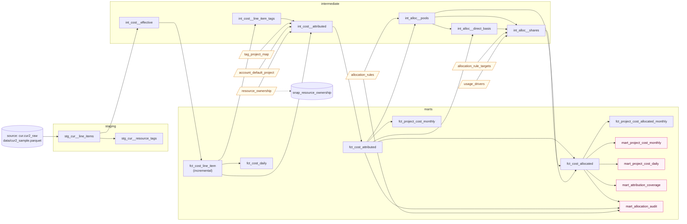
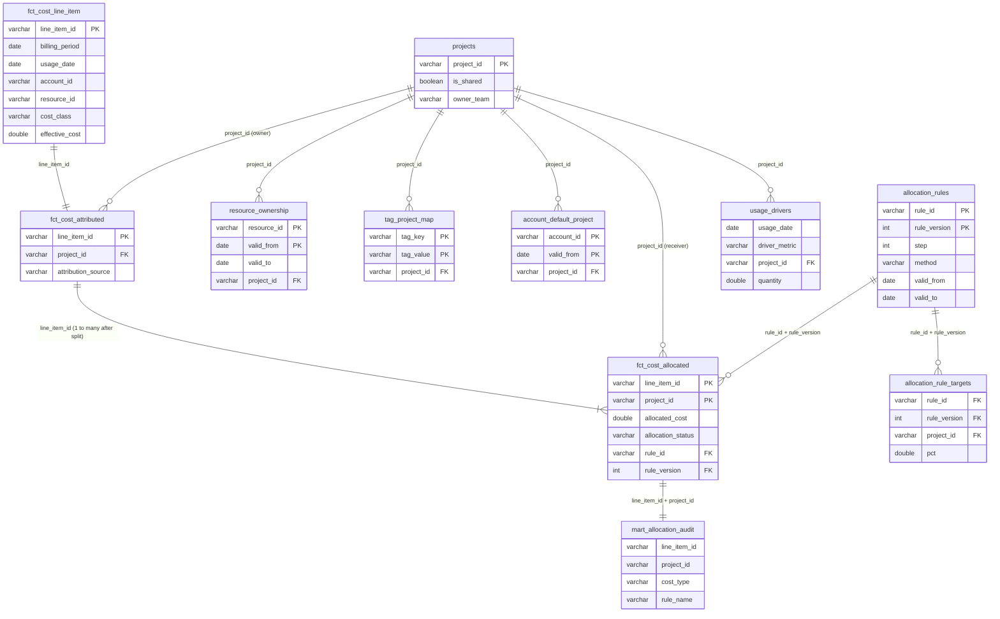

# Lineage and table relationships

Two views of the dbt project: which model is built from which (lineage), and how the main tables join (ERD).
The interactive version of the lineage is in [dbt docs](https://krisanap.github.io/cloud-cost-mgmt/dbt-docs/)
(click the graph icon). For the big picture see [architecture](../README.md#architecture);
for columns see [data-dictionary.md](data-dictionary.md).

## Model lineage

Every `ref()` / `source()` in `dbt/models`, drawn left to right. Seeds are the orange shapes; they are the
only inputs people edit by hand (or through the Streamlit rules page). The `projects` seed is left out to keep
the graph readable: `fct_cost_attributed`, `int_alloc__direct_basis`, `int_alloc__shares` and `fct_cost_allocated`
all join it.

### What each step does

| Step | Model | In one line |
| --- | --- | --- |
| Clean | `stg_cur__line_items` | Cast types, rename CUR 2.0 columns, 1 row = 1 line item |
| | `stg_cur__resource_tags` | Explode the tag JSON into rows, lower-case and trim keys/values |
| Effective cost | `int_cost__effective` | Amortized cost per line + `cost_class` |
| | `fct_cost_line_item` | Same, stored incrementally by billing period (restatement-safe) |
| Attribution | `int_cost__line_item_tags` | Tags for every month already in the fact table |
| | `int_cost__attributed` | Pick the owner: override › tag › account default › unattributed |
| | `fct_cost_attributed` | Adds project details, rebuilt in full so ownership fixes reach past months |
| Allocation | `int_alloc__pools` | Lines owned by a shared pool that match a rule (lowest step wins) |
| | `int_alloc__direct_basis` | Each project's direct cost per day, the basis for `proportional_direct` |
| | `int_alloc__shares` | Split each pool line by the rule's method, then largest remainder to the 6th decimal |
| | `fct_cost_allocated` | Direct lines (1 row) + split lines (1 row per receiver) |
| Report | `mart_*` | Shapes for the dashboard and the audit page |

### Step-down

Rules run in `step` order. Step 1 splits shared infrastructure (EKS, network, unused commitments).
Step 2 splits support, tax and credits **in proportion to direct cost plus what each project received in
step 1**, so a project that uses a lot of shared infrastructure also carries its fair part of support and tax.
A project that receives a share can never be a pool, so money never loops back (tested).

## Table relationships (ERD)

Keys that join the main tables. All `*_id` keys are varchar.

Date-ranged joins (`resource_ownership`, `account_default_project`, `allocation_rules`) match when
`valid_from <= usage_date < coalesce(valid_to, '9999-12-31')`. Tests make sure ranges for the same key never overlap,
so each line finds at most one row.
