# Tests and reconciliation

The one promise of this project: **every dollar on the bill ends up on exactly one project, and the totals
match the bill every month.** These tests keep that promise. They all run in `dbt build` and in CI on every pull request.

| Suite | Count | Where | Run |
| --- | ---: | --- | --- |
| dbt reconciliation tests (custom SQL) | 11 | `dbt/tests/*.sql` | `dbt build` |
| dbt generic tests on columns and seeds | 65 | `_*.yml` next to models and seeds | `dbt build` |
| dbt unit tests (fixed inputs, expected outputs) | 2 | `dbt/models/intermediate/_intermediate.yml` | `dbt build` |
| Restatement simulation | 1 script | `scripts/simulate_restatement.sh` | CI `dbt.yml` |
| Streamlit tests (pytest) | 8 | `tests/` | `pytest -q tests` |

A dbt test passes when its query returns **0 rows**. Each row it returns is one problem, so the result is also
the list of what to fix.

## 1. Reconciliation: money is never lost or double counted

Follow the money from the raw file to the dashboard. Each arrow is checked by a test.

```mermaid
flowchart LR
    RAW["raw CUR file"] -- "assert_totals_match_raw" --> FACT["fct_cost_line_item"]
    FACT -- "assert_attribution_preserves_totals" --> ATT["fct_cost_attributed"]
    ATT -- "assert_allocation_conserves_cost<br/>assert_allocated_total_equals_bill" --> ALC["fct_cost_allocated"]
    ALC -- "assert_marts_match_allocated" --> MART["marts"]
```

| Test | Guarantees | If it fails, it usually means |
| --- | --- | --- |
| `assert_totals_match_raw` | Per month: row count, unblended, net unblended and effective cost are equal in the raw file, staging, `fct_cost_line_item` and `fct_cost_daily` (±$0.01) | A filter or join dropped/duplicated rows; or AWS added upfront fees, which the effective formula does not handle yet |
| `assert_commitments_fully_amortized` | Per Savings Plan / RI per month: fee paid = cost moved onto usage lines + unused part | The amortization formula is wrong, so commitment money vanished or was counted twice |
| `assert_attribution_preserves_totals` | Attaching owners does not add or drop rows or cents, per month | A one-to-many join in attribution (e.g. two overlapping ownership rows) |
| `assert_allocation_conserves_cost` | Per bill line: sum of all shares = the line's effective cost (exact for unsplit lines, to 6 decimals for split lines) | A share was lost in rounding or a target was dropped |
| `assert_allocated_total_equals_bill` | **Per month: total after allocation = the bill in the raw file** | Anything above, seen from the top |
| `assert_marts_match_allocated` | Monthly, daily and audit marts each add up to `fct_cost_allocated` (±$0.01) | A mart filters or joins away rows |

## 2. Allocation rules are safe

| Test | Guarantees | If it fails |
| --- | --- | --- |
| `assert_allocation_targets_valid` | A rule's pool is a shared project (or `unattributed`); a project receiving a share is never shared or `unattributed`; every rule has a pool | Money could loop between pools or be "allocated" back to unattributed. Fix the rule seed |
| `assert_rules_do_not_collide` | A bill line matches at most one rule per step | Two rules' filters overlap; one line would be split twice |
| `assert_fixed_pct_sums_to_100` | Each `fixed_pct` rule version has targets and their % add up to 100 | Fix `allocation_rule_targets` |
| `assert_no_negative_allocation` | A share is negative only when the source line is a credit/refund, and always has the same sign as the source | A rule split a credit into charges, or the reverse |
| `assert_no_overlapping_ranges` (generic, ×3) | No two date ranges overlap for the same `resource_id` (ownership), `account_id` (account default), or `rule_id` (rules) | Two versions are valid on the same day, so one line would get two owners or two rules |

The Streamlit rules page runs the same checks in Python (`streamlit_app/lib.py`) before it saves a seed,
so a bad rule is rejected before dbt sees it.

## 3. Grain and keys

| Test | Guarantees |
| --- | --- |
| `unique` + `not_null` on `line_item_id` in staging, effective, fact, attributed and pools | One row per bill line at every stage |
| unique `(line_item_id, project_id)` in `int_alloc__shares` and `fct_cost_allocated` | A project gets at most one share of each line |
| unique `(billing_period, project_id)` in `mart_project_cost_monthly` | One row per project per month |
| `assert_daily_grain_unique` | One row per day × account × service × resource × cost class in `fct_cost_daily` |
| unique `(rule_id, rule_version)`, `(tag_key, tag_value)`, `project_id` in seeds | Seeds have no duplicate keys |

## 4. Allowed values and references

| Test | Guarantees |
| --- | --- |
| `accepted_values` on `line_item_type` (10 values), `currency_code` (USD) | The source has no line type or currency the logic does not know |
| `accepted_values` on `cost_class`, `attribution_source`, `allocation_status`, `method`, `resource_ownership.source` | Every row lands in a known bucket |
| `relationships` → `projects` (10 tests) | Every `project_id` in seeds and outputs exists in `projects` |
| `not_null` (30 tests, incl. 2 on the source file) | Keys, costs, dates and owners are never missing |

## 5. Unit tests: the tricky cases on purpose

Small fixed inputs with hand-computed answers, so the logic is tested even for cases the sample data
does not contain.

**`attribution_rules_and_date_ranges`** (model `int_cost__attributed`)

| Case | Input | Expected |
| --- | --- | --- |
| Owner moves mid-month | Resource tagged `storefront`, override to `search-api` from Aug 15 | Aug 14 → storefront (tag), Aug 15 → search-api (override) |
| No tag | Account 777 has a default project | → account default |
| Late tag | No tag in July, tag in September, override backfills July | July → override, September → tag |
| Nothing at all | No tag, override or default | → `unattributed` |
| Messy tag | `" User_Service ": " ML "` | Normalized, maps to `ml` |
| Range end | Override valid to Sep 1 | Sep 1 itself is **not** covered (`[from, to)`) → back to tag |

**`alloc_even_fixed_driver_and_step_down`** (model `int_alloc__shares`, at 2 decimals)

| Case | Input | Expected |
| --- | --- | --- |
| Even split with remainder | $10 to A, B, C | 3.34 / 3.33 / 3.33 (largest remainder, total stays $10.00) |
| Usage driver | $40 by vCPU-hours A=1, C=3 | 10 / 30 |
| Step-down proportional | $100 at step 2, direct A=30, B=10, plus what each got in step 1 | 48.15 / 14.81 / 37.04 |
| Fixed % | $1 at 60:40 | 0.60 / 0.40 |

## 6. Restatement

AWS rewrites the current month's CUR several times a day. `scripts/simulate_restatement.sh` builds once,
then points dbt at a file where September was rewritten, builds again, and checks that September was
replaced (not appended) while July and August stayed the same. This proves the incremental
delete+insert by `billing_period` works.

## 7. Streamlit (pytest)

| Test | Checks |
| --- | --- |
| `test_page_renders` ×3 | Home and both pages open headless without errors |
| `test_audit_page_shows_rules_for_august_storefront` | The audit page lists the rules that sent money to a project |
| `test_current_seeds_are_valid` | The committed rule seeds pass validation |
| `test_fixed_pct_must_sum_to_100` | Validation rejects fixed percentages that add up to 90 |
| `test_overlapping_versions_rejected` | Validation rejects two versions valid on the same day |
| `test_pool_must_be_shared_and_target_not_shared` | Validation rejects loops |

## When a test fails

1. Run `dbt build --profiles-dir . --select <test_name>` and read the rows it returns: each row is one broken line, month or rule.
2. Open the compiled SQL in `dbt/target/compiled/cloud_cost/tests/` and run it in DuckDB to dig in.
3. For seed problems (ranges, rules, percentages), fix the CSV; for logic problems, fix the model and add a
   unit test for the case.

Never loosen a tolerance or delete a test to get green: the totals matching the bill is the point of the project.
